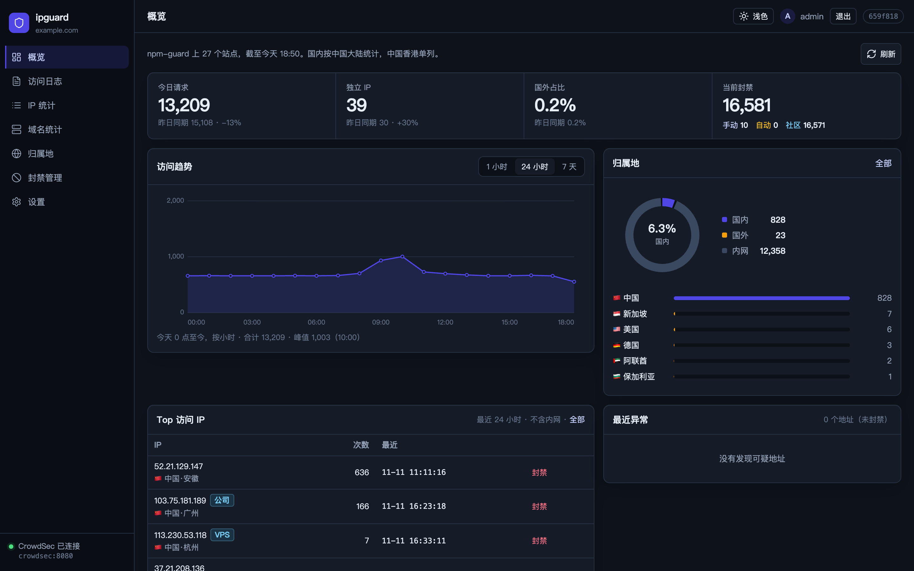
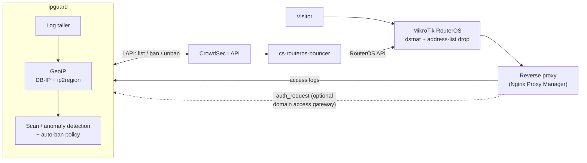
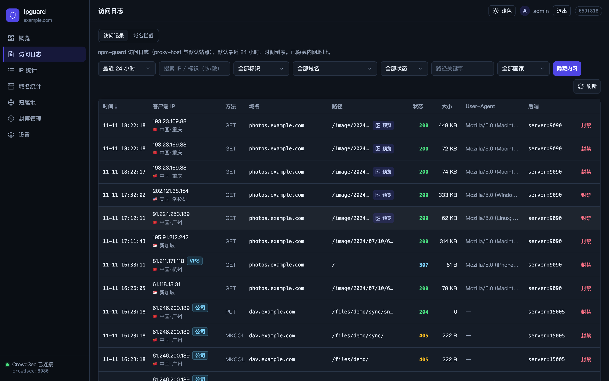
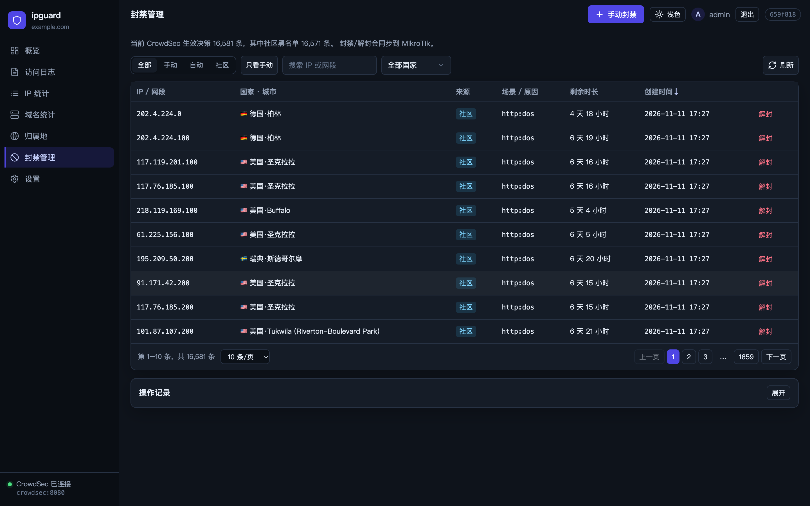
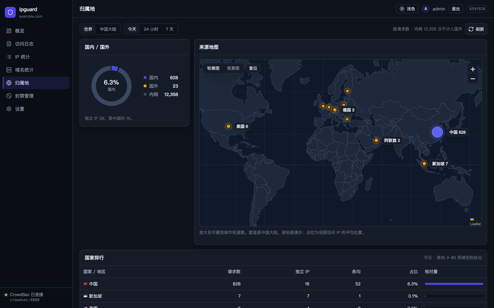
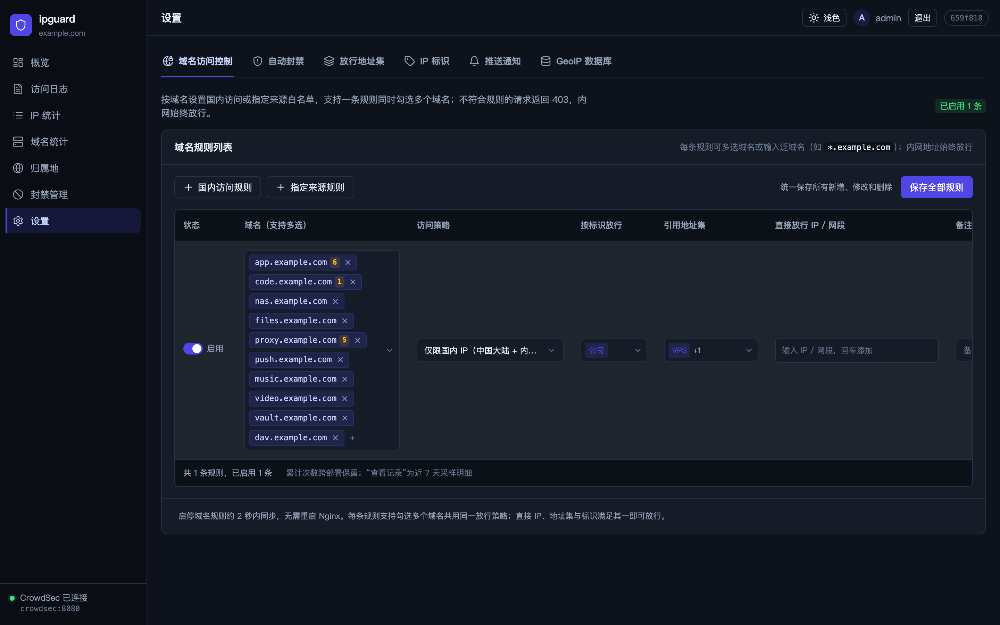

# ipguard

**English** | [简体中文](README_zh.md)

[](https://github.com/duskedge/ipguard/actions/workflows/build.yml)
[](https://github.com/duskedge/ipguard/pkgs/container/ipguard)
[](https://github.com/duskedge/ipguard/releases)
[](LICENSE)

A self-hosted security dashboard for home labs and small edge networks. It reads your reverse-proxy access logs, enriches every visitor with **city-level GeoIP**, highlights **scanners and suspicious IPs**, and lets you **ban / unban in one click through CrowdSec** — with the block enforced on your **MikroTik RouterOS** firewall.



> The UI is in Simplified Chinese.

---

## Requirements (read this first)

ipguard is the *visibility and control* layer of a specific edge-protection setup. It does **not** block traffic by itself.

| Component | Required | Why |
| :--- | :---: | :--- |
| **MikroTik RouterOS v7** | **Yes** | This is where bans take effect. ipguard writes decisions to CrowdSec, and [`cs-routeros-bouncer`](https://github.com/jmrplens/cs-routeros-bouncer) syncs them into a RouterOS `address-list` that is dropped at the WAN interface (raw/prerouting). The UI hints and the one-command installer are built around RouterOS. |
| **CrowdSec** (Security Engine + LAPI) | **Yes** | Source of truth for decisions. ipguard registers as a CrowdSec *machine* to list, add and delete decisions over HTTP — no `docker.sock` needed. |
| **Reverse proxy with real client IPs** | **Yes** | ipguard analyses the proxy's access logs. [Nginx Proxy Manager](https://nginxproxymanager.com/) per-host logs are preferred (they carry the host and backend); plain nginx `combined` logs also work. The logged client IP must be the **real** visitor IP, not a Docker bridge address. |
| **Docker + Compose v2** (Linux host) | **Yes** | Deployment target. Images are published for `linux/amd64` and `linux/arm64`. |

Without RouterOS (or another working CrowdSec bouncer), ipguard still shows logs, GeoIP and statistics and still records decisions in CrowdSec — but nothing gets blocked on the network. Other CrowdSec bouncers can enforce the same decisions in principle, but that setup is not tested here.

---

## How it works



1. **Log ingestion** — tails the proxy log directory incrementally (rotated `.1` / `.gz` files included) and keeps a sliding window (7 days by default) in memory.
2. **GeoIP** — resolves visitors with **DB-IP City Lite**, refined by **ip2region** for accurate Chinese province / city / ISP data. Private and reserved ranges are recognised automatically.
3. **Detection** — flags *scan* and *suspicious* IPs from sensitive-path hits (`/.env`, `/.git`, `wp-login`, …) and error ratios. An optional **auto-ban policy** escalates repeated offenders into CrowdSec decisions, with exemptions for LAN, tagged and allow-listed IPs.
4. **Banning** — bans or unbans an IP or CIDR with a duration and reason. The decision goes to CrowdSec, and the bouncer pushes it to RouterOS.
5. **Domain access gateway (optional)** — the proxy asks ipguard via `auth_request` whether a visitor may reach a domain (e.g. *mainland-China only* or *allow-list only*). If ipguard is unreachable the gateway **fails open**, so traffic is never broken by ipguard being down.

## Features

- **Dashboard** — traffic trend, status codes, domestic vs. overseas share, top and anomalous IPs.
- **Access logs** — fast filtering by time, IP, host, status, path and region, with image previews.
- **IPs & domains** — per-IP drill-down (timeline, paths, user agents), per-domain traffic and backend labels resolved from NPM configs.
- **Geo** — world map and China province / city breakdown.
- **Bans** — CrowdSec decisions grouped by origin (manual, CrowdSec scenarios, community blocklist); one-click ban / unban; audit trail.
- **Domain access rules** — per-domain *domestic-only* or *allow-list* policies with IP tags and address sets; block counters and a blocked-request log.
- **IP tags & address sets** — name trusted IPs / CIDRs (office, home, VPS) and reuse them in rules and exemptions.
- **Notifications** — JSON webhook alerts for suspicious activity and auto-bans, with cooldown.

| Access logs | Bans |
| :---: | :---: |
|  |  |
| **Geo** | **Domain access rules** |
|  |  |

---

## Deployment

Two options. Both use the published image `ghcr.io/duskedge/ipguard`. Tags follow releases: `latest`, `1`, `1.0`, `1.0.0`. Pin a version in production via `IPGUARD_IMAGE`. Prebuilt binaries for linux amd64/arm64 are attached to each [release](https://github.com/duskedge/ipguard/releases).

### Option A — one-command edge stack (fresh setup)

[`deploy/edge-stack`](deploy/edge-stack) brings up the whole chain on one Docker host: **CrowdSec + cs-routeros-bouncer + Nginx Proxy Manager (real client IPs via macvlan) + ipguard**, optionally **AdGuard Home**. It also provisions RouterOS for you: a restricted API account and the public-port `dstnat`, both via the RouterOS REST API.

Extra prerequisites for this option:

- RouterOS v7 with the **`api`** service (8728, used by the bouncer) and the **`www`** service (REST API, used by the installer) reachable from the Docker host. You type the RouterOS admin password **once** at the prompt. It is used to create the restricted account and is never stored.
- Two free LAN IPs outside the DHCP pool (for the proxy and the macvlan shim), and the name of the host's LAN interface.
- `python3` on the host.
- Optional: a Cloudflare API token (`Zone:DNS:Edit`) to issue a wildcard certificate automatically.

```bash
git clone https://github.com/duskedge/ipguard.git
cd ipguard/deploy/edge-stack
cp .env.example .env && vi .env                     # network, RouterOS, domain, passwords
cp overlay/ipguard.env.example overlay/ipguard.env  # ipguard login password
./setup.sh --with-ipguard --with-adguard           # full stack: + ipguard + AdGuard Home
```

> **Don't need AdGuard Home?** Drop `--with-adguard` (e.g. host port `53` is already in use). Use the **same flags** for every later `--verify` / `--down`, otherwise the omitted containers are not managed.

`./setup.sh --with-ipguard --with-adguard --down` stops everything and removes what the installer created on RouterOS: the `dstnat` rule, the address list, the raw rules and the restricted account. See [`deploy/edge-stack/README.md`](deploy/edge-stack/README.md) for details.

### Option B — standalone ipguard (existing CrowdSec + bouncer + proxy)

**1. Register ipguard as a CrowdSec machine.** A bouncer key is read-only; a machine can query, add and delete decisions.

```bash
docker exec crowdsec cscli machines add ipguard --password '<crowdsec-password>' -f /dev/null
```

**2. Configure and start.**

```bash
git clone https://github.com/duskedge/ipguard.git && cd ipguard
cp deploy/ipguard.env.example deploy/.env && chmod 600 deploy/.env
vi deploy/.env     # PROXY_LOGS_DIR, CROWDSEC_NETWORK, login + CrowdSec credentials
docker compose -f deploy/docker-compose.yml --env-file deploy/.env up -d
```

Open `http://<host>:28090`. Keep the panel on your LAN or VPN, or publish it through the reverse proxy with authentication. Do not expose port 28090 directly.

**3. (Optional) Enable the domain access gateway** in Nginx Proxy Manager. Copy the templates from [`deploy/edge-stack/config/nginx/custom/`](deploy/edge-stack/config/nginx/custom) into NPM's `data/nginx/custom/`. Replace `__IPGUARD_HOST__` with an address the proxy container can reach ipguard on, append `ipguard_gate_block.conf` to `server_proxy.conf`, include `ipguard_http.conf` from `http_top.conf`, then reload NPM. Rules are managed in **Settings → 域名访问控制**.

---

## Configuration

Settings come from `$IPGUARD_CONFIG` → `./config.yaml` → `./data/config.yaml`. Every key can be overridden with an environment variable `IPGUARD_<SECTION>_<KEY>`. See [`config.example.yaml`](config.example.yaml) for the full list.

| Section | Common environment variables | Description |
| :--- | :--- | :--- |
| `server` | `IPGUARD_SERVER_PORT`, `IPGUARD_SERVER_SITE`, `IPGUARD_SERVER_TIMEZONE` | Listen port (default `8080`), sidebar subtitle, timezone for daily buckets |
| `auth` | `IPGUARD_AUTH_USERNAME`, `IPGUARD_AUTH_PASSWORD` / `IPGUARD_AUTH_PASSWORDHASH` | Admin login. Generate a bcrypt hash with `docker run --rm ghcr.io/duskedge/ipguard hash-password '<password>'` |
| `logs` | `IPGUARD_LOGS_DIR`, `IPGUARD_LOGS_RETENTION`, `IPGUARD_LOGS_BACKENDALIASES` | Log directory, in-memory window, friendly names for backend addresses |
| `geoip` | `IPGUARD_GEOIP_CITYDB`, `IPGUARD_GEOIP_REGIONDB` | Optional newer databases. The image ships with both. |
| `crowdsec` | `IPGUARD_CROWDSEC_URL`, `IPGUARD_CROWDSEC_MACHINEID`, `IPGUARD_CROWDSEC_PASSWORD` | LAPI endpoint and machine credentials |
| `detect` | `IPGUARD_DETECT_SCANHITS`, `IPGUARD_DETECT_WARNMINREQ` | Thresholds for *scan* / *suspicious* highlighting |

Notifications, auto-ban policy, IP tags, address sets and domain rules are configured in the web UI and stored under the data directory.

## Development

```bash
make geoip        # download DB-IP City Lite + ip2region into data/geoip/
make run          # backend on :8080 (reads .env.local if present)
make web-dev      # frontend dev server, proxies /api to :8080
make test         # Go + web tests
make docker       # build the image locally (deploy/Dockerfile, multi-arch capable)
```

`make web-embed && make build` produces a single binary with the UI embedded. Run `make web-embed-reset` before committing.

## Security notes

- The panel holds CrowdSec machine credentials that can add and delete bans. Keep it private.
- The domain access gateway is fail-open by design. It is an access policy, not your only line of defence.
- Webhook headers (e.g. tokens) are stored with `0600` permissions and never returned to the browser.

## License & attribution

[MIT](LICENSE).

- IP geolocation by [DB-IP](https://db-ip.com) (City Lite, [CC BY 4.0](https://creativecommons.org/licenses/by/4.0/)).
- Chinese region data by [ip2region](https://github.com/lionsoul2014/ip2region) (Apache-2.0).
- Ban enforcement by [CrowdSec](https://www.crowdsec.net/) and [cs-routeros-bouncer](https://github.com/jmrplens/cs-routeros-bouncer).
