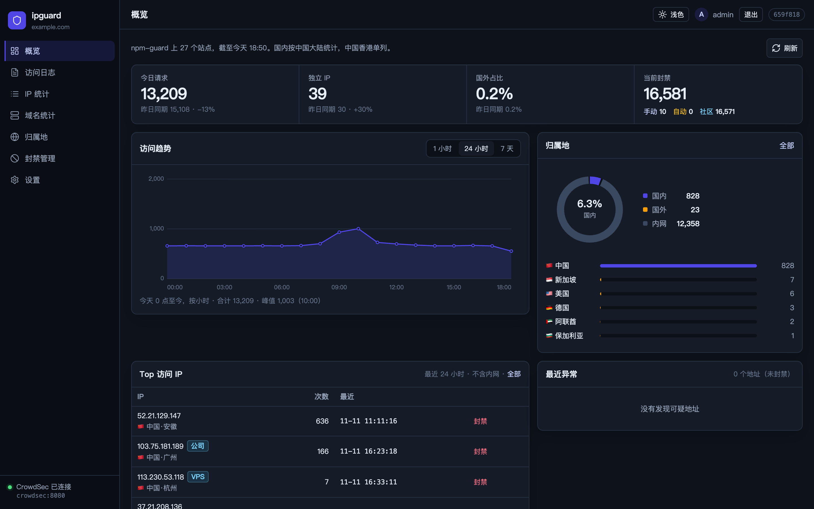
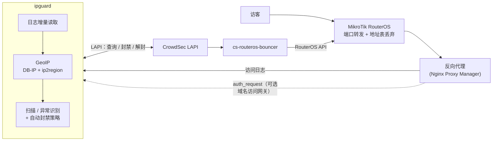
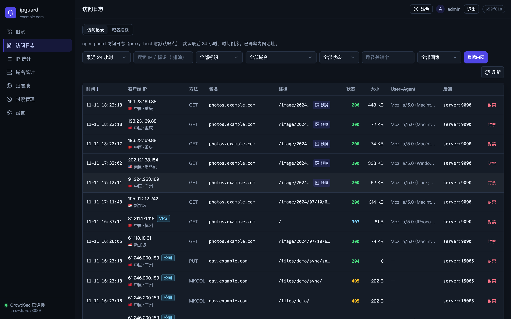
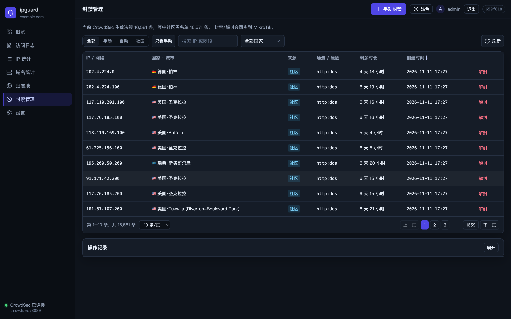
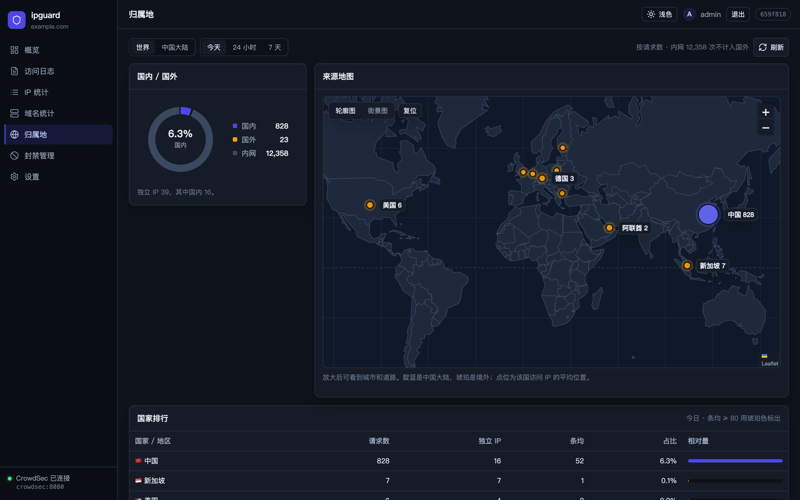
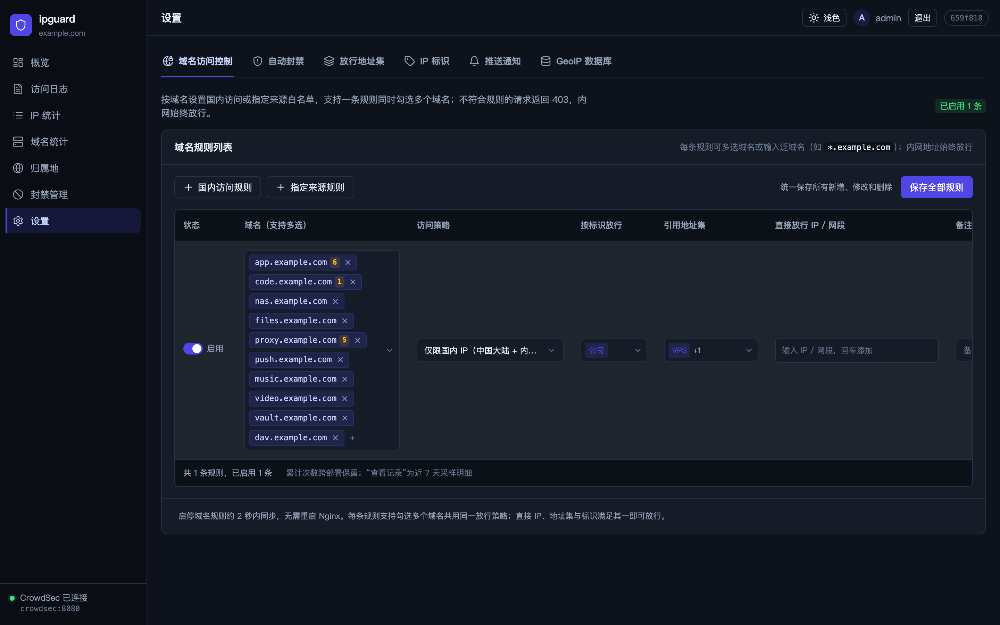

# ipguard

[English](README.md) | **简体中文**

[](https://github.com/duskedge/ipguard/actions/workflows/build.yml)
[](https://github.com/duskedge/ipguard/pkgs/container/ipguard)
[](https://github.com/duskedge/ipguard/releases)
[](LICENSE)

面向家庭实验室和小型边缘网络的自建安全面板：读取反向代理的访问日志，给每个访客补上**城市级 GeoIP**，标出**扫描器和可疑 IP**，并支持**通过 CrowdSec 一键封禁 / 解封**，封禁最终落在 **MikroTik RouterOS** 防火墙上。



---

## 前置条件（务必先看）

ipguard 是一套边缘防护方案里负责**可视化和操作**的部分，**它自己不拦截任何流量**。

| 组件 | 必需 | 说明 |
| :--- | :---: | :--- |
| **MikroTik RouterOS v7** | **是** | 封禁在这里生效。ipguard 把决策写进 CrowdSec，再由 [`cs-routeros-bouncer`](https://github.com/jmrplens/cs-routeros-bouncer) 同步到 RouterOS 的 `address-list`，在 WAN 入口（raw/prerouting）丢弃。界面提示和一键部署脚本都按 RouterOS 设计。 |
| **CrowdSec**（检测引擎 + LAPI） | **是** | 封禁决策的唯一来源。ipguard 以 CrowdSec *machine* 身份通过 HTTP 查询、新增、删除决策，不需要挂载 `docker.sock`。 |
| **能记录真实客户端 IP 的反向代理** | **是** | ipguard 分析的是反代的访问日志。首选 [Nginx Proxy Manager](https://nginxproxymanager.com/) 的按站点日志（带域名和后端地址），标准 nginx `combined` 格式也能用。日志里的客户端 IP 必须是**真实访客 IP**，不能是 Docker 网桥地址。 |
| **Docker + Compose v2**（Linux 主机） | **是** | 部署方式。镜像提供 `linux/amd64` 与 `linux/arm64`。 |

没有 RouterOS（或其他能正常工作的 CrowdSec bouncer）时，ipguard 仍然可以看日志、地域和统计，也能把决策写进 CrowdSec，但**网络上不会真的拦截**。理论上其他 CrowdSec bouncer 也能执行同样的决策，但这种组合没有经过验证。

---

## 工作原理



1. **日志采集**：增量读取反代日志目录（含轮转出的 `.1` / `.gz`），默认在内存里保留 7 天的滑动窗口。
2. **GeoIP**：用 **DB-IP City Lite** 解析全球城市级位置，再用 **ip2region** 修正国内的省、市和运营商；自动识别内网和保留地址。
3. **异常识别**：根据敏感路径命中（`/.env`、`/.git`、`wp-login` 等）和错误率标记"扫描"和"可疑"IP。可选的**自动封禁策略**会把反复违规的 IP 升级为 CrowdSec 决策，内网、带标识的 IP 和放行地址集自动豁免。
4. **封禁**：对 IP 或网段一键封禁 / 解封，可设时长和原因。决策写入 CrowdSec，由 bouncer 推送到 RouterOS。
5. **域名访问网关（可选）**：反代通过 `auth_request` 询问 ipguard 某个访客能否访问某个域名，例如"仅中国大陆"或"仅白名单"。ipguard 不可达时网关**自动放行（fail-open）**，不会因为 ipguard 故障影响正常访问。

## 功能

- **总览**：流量趋势、状态码分布、国内外占比、热门和异常 IP。
- **访问日志**：按时间、IP、域名、状态码、路径、地区快速筛选，支持图片预览。
- **IP 与域名**：单 IP 下钻（时间线、访问路径、UA），按域名统计流量，并从 NPM 配置解析后端标签。
- **地域**：世界地图与国内省市分布。
- **封禁**：按来源（手动、CrowdSec 场景、社区黑名单）分组查看决策，一键封禁 / 解封，完整操作审计。
- **域名访问控制**：按域名设置"仅国内"或"仅白名单"，可引用 IP 标识和地址集，带拦截计数和拦截记录。
- **IP 标识与地址集**：给可信 IP / 网段起名（公司、家宽、VPS），在规则和豁免中复用。
- **通知**：可疑访问和自动封禁通过 JSON Webhook 推送，带冷却时间。

| 访问日志 | 封禁 |
| :---: | :---: |
|  |  |
| **地域** | **域名访问控制** |
|  |  |

---

## 部署

两种方式都使用已发布的镜像 `ghcr.io/duskedge/ipguard`。镜像标签跟随版本发布：`latest`、`1`、`1.0`、`1.0.0`，生产环境建议通过 `IPGUARD_IMAGE` 固定版本。每个 [Release](https://github.com/duskedge/ipguard/releases) 还附带 linux amd64/arm64 的二进制包。

### 方式 A：edge-stack 一键整套（全新搭建）

[`deploy/edge-stack`](deploy/edge-stack) 在一台 Docker 主机上拉起整条链路：**CrowdSec + cs-routeros-bouncer + Nginx Proxy Manager（macvlan 拿真实客户端 IP）+ ipguard**，可选 **AdGuard Home**。它还会通过 RouterOS REST API 自动配置路由器：建一个受限 API 账号，并添加公网端口的 `dstnat`。

这种方式额外需要：

- RouterOS v7，并且 Docker 主机能访问到它的 **`api`** 服务（8728，bouncer 用）和 **`www`** 服务（REST API，部署脚本用）。部署时按提示**输入一次** RouterOS admin 密码，只用来建受限账号，不会保存。
- 两个不在 DHCP 池里的空闲内网 IP（给反代和 macvlan shim），以及宿主机的内网网卡名。
- 宿主机装有 `python3`。
- 可选：Cloudflare API Token（`Zone:DNS:Edit`），用于自动申请泛域名证书。

```bash
git clone https://github.com/duskedge/ipguard.git
cd ipguard/deploy/edge-stack
cp .env.example .env && vi .env                     # 网络、RouterOS、域名、各类口令
cp overlay/ipguard.env.example overlay/ipguard.env  # ipguard 登录口令
./setup.sh --with-ipguard                           # 需要 AdGuard Home 再加 --with-adguard
```

`./setup.sh --with-ipguard --down` 会停掉所有服务，并删除脚本在 RouterOS 上创建的内容：`dstnat` 规则、地址表、raw 规则和受限账号。详见 [`deploy/edge-stack/README.md`](deploy/edge-stack/README.md)。

### 方式 B：单独部署 ipguard（已有 CrowdSec + bouncer + 反代）

**1. 在 CrowdSec 中把 ipguard 注册为 machine。** bouncer 的 key 只能读；machine 才能查询、新增和删除决策。

```bash
docker exec crowdsec cscli machines add ipguard --password '<crowdsec 口令>' -f /dev/null
```

**2. 配置并启动。**

```bash
git clone https://github.com/duskedge/ipguard.git && cd ipguard
cp deploy/ipguard.env.example deploy/.env && chmod 600 deploy/.env
vi deploy/.env     # PROXY_LOGS_DIR、CROWDSEC_NETWORK、登录口令和 CrowdSec 凭据
docker compose -f deploy/docker-compose.yml --env-file deploy/.env up -d
```

打开 `http://<主机>:28090`。面板请只在内网或 VPN 内访问，或者经反代并加上认证后再对外，不要直接暴露 28090 端口。

**3.（可选）在 Nginx Proxy Manager 中启用域名访问网关。** 把 [`deploy/edge-stack/config/nginx/custom/`](deploy/edge-stack/config/nginx/custom) 下的模板复制到 NPM 的 `data/nginx/custom/`。把 `__IPGUARD_HOST__` 换成反代容器能访问到 ipguard 的地址，把 `ipguard_gate_block.conf` 追加到 `server_proxy.conf` 末尾，在 `http_top.conf` 里 include `ipguard_http.conf`，然后重载 NPM。规则在 **设置 → 域名访问控制** 中管理。

---

## 配置

配置文件查找顺序：`$IPGUARD_CONFIG` → `./config.yaml` → `./data/config.yaml`。所有配置项都可以用环境变量 `IPGUARD_<分组>_<键>` 覆盖，完整列表见 [`config.example.yaml`](config.example.yaml)。

| 分组 | 常用环境变量 | 说明 |
| :--- | :--- | :--- |
| `server` | `IPGUARD_SERVER_PORT`、`IPGUARD_SERVER_SITE`、`IPGUARD_SERVER_TIMEZONE` | 监听端口（默认 `8080`）、侧栏副标题、按天统计用的时区 |
| `auth` | `IPGUARD_AUTH_USERNAME`、`IPGUARD_AUTH_PASSWORD` / `IPGUARD_AUTH_PASSWORDHASH` | 管理员登录。生成 bcrypt 哈希：`docker run --rm ghcr.io/duskedge/ipguard hash-password '<口令>'` |
| `logs` | `IPGUARD_LOGS_DIR`、`IPGUARD_LOGS_RETENTION`、`IPGUARD_LOGS_BACKENDALIASES` | 日志目录、内存保留时长、后端地址别名 |
| `geoip` | `IPGUARD_GEOIP_CITYDB`、`IPGUARD_GEOIP_REGIONDB` | 可选的更新版数据库；镜像已内置两个库 |
| `crowdsec` | `IPGUARD_CROWDSEC_URL`、`IPGUARD_CROWDSEC_MACHINEID`、`IPGUARD_CROWDSEC_PASSWORD` | LAPI 地址与 machine 凭据 |
| `detect` | `IPGUARD_DETECT_SCANHITS`、`IPGUARD_DETECT_WARNMINREQ` | "扫描"和"可疑"的判定阈值 |

通知、自动封禁策略、IP 标识、地址集和域名规则都在网页里配置，保存在数据目录下。

## 开发

```bash
make geoip        # 下载 DB-IP City Lite 与 ip2region 到 data/geoip/
make run          # 后端监听 :8080（存在 .env.local 时读取）
make web-dev      # 前端开发服务器，/api 代理到 :8080
make test         # Go 与前端测试
make docker       # 本地构建镜像（deploy/Dockerfile，支持多平台）
```

`make web-embed && make build` 可以得到内嵌前端的单文件二进制；提交代码前运行 `make web-embed-reset`。

## 安全提示

- 面板持有的 CrowdSec machine 凭据可以新增和删除封禁，请勿对公网开放。
- 域名访问网关按设计是 fail-open，它是访问策略，不应作为唯一的防线。
- Webhook 请求头（例如 Token）以 `0600` 权限保存，且不会回传给浏览器。

## 许可证与致谢

[MIT](LICENSE)。

- IP 地理位置数据来自 [DB-IP](https://db-ip.com)（City Lite，[CC BY 4.0](https://creativecommons.org/licenses/by/4.0/)）。
- 国内地区数据来自 [ip2region](https://github.com/lionsoul2014/ip2region)（Apache-2.0）。
- 封禁执行依赖 [CrowdSec](https://www.crowdsec.net/) 与 [cs-routeros-bouncer](https://github.com/jmrplens/cs-routeros-bouncer)。
